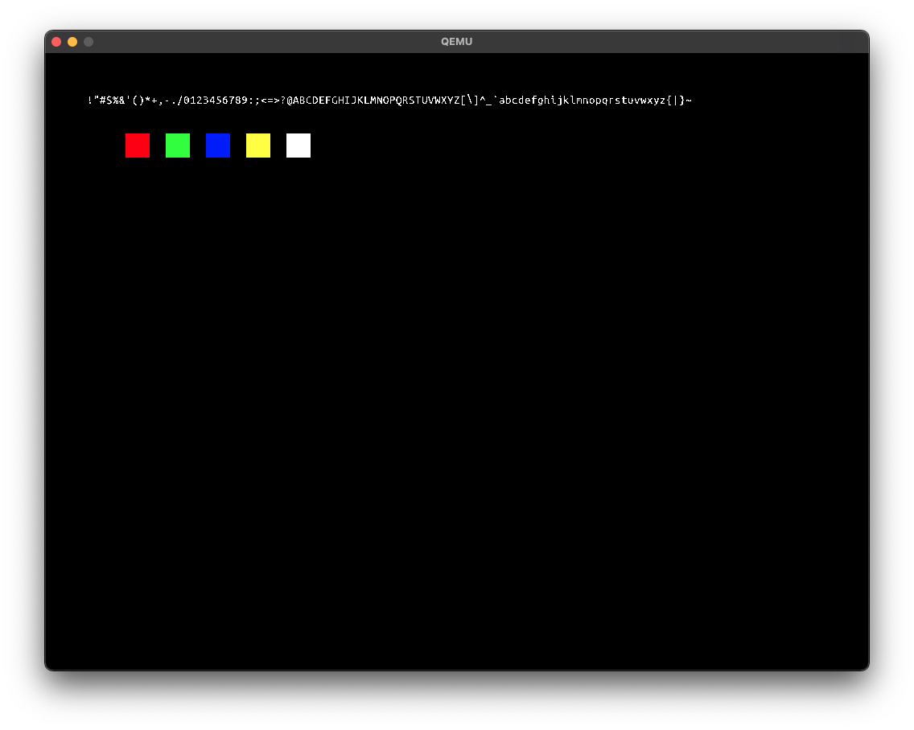

# Feather OS

 Hobby operating system targeting x86-64 and AArch64, built to learn kernel and operating system development.

## Tech stack

* Compiler g++
* Language: ASM, C, C++
* Build system: CMAKE
* Bootloader: [Limine](https://github.com/limine-bootloader/limine)
* Emulator: QEMU

## Development

See the [FeatherOS roadmap](docs/roadmap.md) for planned kernel milestones.

1. Clone the project
   `git clone https://github.com/marksinkovics/FeatherOS.git`
2. Build the project with all components
   `./build.sh --arch x86_64 all`
   In the case of successful build the script will run the build kernel in QEMU
3. Run the built kernel in QEMU
   `./build.sh --arch x86_64 run`

Run the unittest-based QEMU boot and panic integration matrix for both x86-64 and AArch64 with `./build.sh test-all`.

## Using FeatherOS

`./build.sh --arch x86_64 run` (or `--arch aarch64`) boots to a shell, in the QEMU window and on the terminal you started it from. The window scales with its size; set `QEMU_ZOOM=0` to show the guest's 1024x768 screen pixel for pixel instead. Type `help` for the commands, and `<command> --help` for what one does.

### Keyboard shortcuts

At the shell prompt:

| Keys | Action |
| --- | --- |
| Left, Right (Ctrl+B, Ctrl+F) | Move one character |
| Home, End (Ctrl+A, Ctrl+E) | Go to the start or end of the line |
| Backspace (Ctrl+H) | Erase the character before the cursor |
| Delete (Ctrl+D) | Erase the character under the cursor |
| Ctrl+U | Erase from the start of the line to the cursor |
| Ctrl+K | Erase from the cursor to the end of the line |
| Ctrl+W | Erase the word before the cursor |
| Up, Down (Ctrl+P, Ctrl+N) | Walk through the last 32 lines; `history` lists them |
| Ctrl+L | Clear the screen; the `clear` command does the same |
| Ctrl+C | Discard the line |
| Enter | Run the line |

While a command runs, Ctrl+C stops it, along with the rest of its pipeline. `top` redraws in place until `q`. Programs that read a line of their own, such as `calc` and `upper`, support Backspace only. `keys` shows what any key sends.

### vi

`vi [file]` edits a file. It starts in normal mode, where keys are commands; `i` and the other insert keys type text until Escape.

| Keys | Action |
| --- | --- |
| h j k l, the arrows | Move left, down, up, right |
| w b e | Next word, previous word, end of word |
| 0 ^ $, Home End | Start of line, first non-blank, end of line |
| gg G, :N | First line, last line (or line N with a count), line N |
| Ctrl+F Ctrl+B, Page Up Page Down, Ctrl+D Ctrl+U | Page down and up, half a page down and up |
| i a I A o O | Insert before or after the cursor, at the start or end of the line, on a new line below or above |
| x X D | Delete the character under or before the cursor, or to the end of the line |
| dd yy p P | Delete or copy a line, put after or before the cursor |
| J r | Join with the next line, replace one character |
| u Ctrl+R | Undo, redo |
| /text ?text n N | Search forward or back, repeat the search the same or the other way |
| :w [file] :q :q! :wq :x ZZ | Write, quit, quit without saving, write and quit |

A number before a command repeats it, as in `3dd` or `5j`.

## Code Quality

Install the formatting and lint tools listed in [development requirements](docs/development.md). Run `bash tools/quality.sh --fix` to apply available fixes. Install the pre-commit hook with `pre-commit install`; it quietly blocks commits when checks fail and shows diagnostics for issues that need manual repair.

## Screenshot

